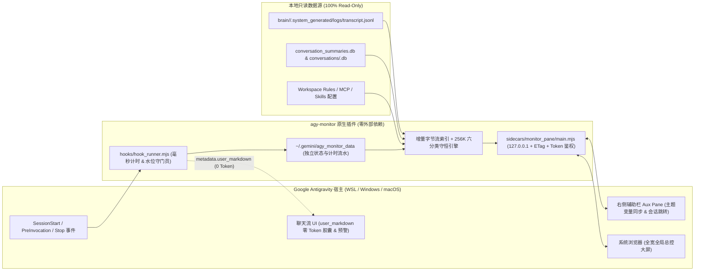

# agy-monitor

**面向 Google Antigravity (AGY) 的原生 `256K` 上下文精确归因、零 Token 压缩预警与跨端全局 Token 遥测仪表盘插件**

`agy-monitor` 基于 Google Antigravity 官方 `SIDECAR_UI_ENTRYPOINT_AUX_PANE` 与生命周期 Hook 机制构建，**零第三方依赖、零 `npm install`、零原生 C++ 编译**，克隆即用。它为 AGY Desktop / IDE / CLI 提供单会话 `256K` 自动压缩红线的六分类守恒拆解、Subagent / Swarm 独立窗口风险透视与一键下钻、模型不可见的零 Token 聊天流快捷胶囊与压缩预警，以及打通 WSL + Windows 双端的全局 Token 用量总控大屏。

---

## 核心亮点

### 1. 锚定 `256K` 真实自动压缩线的六分类守恒归因
- 采用 **「底座锁死 + Step Delta 守恒分摊」** 算法，严格按当前会话自身的实时上下文计算窗口水位（上限锚定 `256,000` Token，标示 `~6K` `Autocompact buffer` 压缩警戒带与安全剩余空间）。
- 将当前压缩周期内的真实上下文 `100%` 守恒拆解为六大分类（分项之和恒等于官方 `input_tokens + cache_read_tokens`）：
  - `Rules 规则文件` · `System 底座与内置工具` · `MCP 工具` · `Skills 技能` · `对话消息与附件` · `工具调用结果`
- 底部单独列出**未加载的按需项**（Lazy MCP / 未激活 Skills 预估体积），并提供 `Rules`、`MCP 工具`、`Skills` 与 **`单步暴涨 Top 明细`** 四个可折叠抽屉，一眼定位哪一步 `read_file` 或 `run_command` 吃掉了上下文。

### 2. Subagent / Swarm 独立 `256K` 风险徽章与一键下钻切换
- **总消耗归集 + 窗口严格隔离**：「本对话总消耗」自动合并主会话与全部派生子智能体（Browser / Research / Swarm Workers）的含缓存总吞吐并展示占比，但顶部 `256K` 进度条绝不混入子智能体窗口。
- **子会话风险透视与 1-Click 下钻**：子智能体列表实时展示每个成员自身的独立 `256K` 占用率、压缩次数与红/黄风险徽章；**点击任意子智能体行即可下钻**查看其独立六分类构成、压缩记录与单步暴涨抽屉，并通过顶部面包屑与兄弟节点胶囊一键横向切换或返回主会话。

### 3. 零 Token 聊天流快捷胶囊与 `80%` / `92%` 临近压缩预警
- 利用官方 `SessionStart` 与 `PreInvocation` Hook 的 `metadata.user_markdown` 通道渲染 UI 提示，同时严格保持 `systemMessage: ""`——**对模型完全不可见，消耗 `0` 模型输入 Token**。
- **聊天内简要状态条**（默认开启，可在面板随时开关）：在会话启动及每轮真实用户提问前注入 `[◔ X% (xx.xk/256k)](sidecar://agy-monitor/monitor_pane/)` 胶囊链接，无需翻找右上角菜单即可一键呼出监控面板（自动识别并跳过 Subagent 与系统内部唤醒，绝不刷屏）。
- **双档位临近压缩预警**（默认开启）：当未压缩周期内上下文首次突破 **`80%`（`204.8K`）** 或 **`92%`（`235.5K`）** 时主动弹出醒目提醒，辅助在自动 `CHECKPOINT` 压缩前主动整理上下文；触发压缩后水位锁自动重置。

### 4. `gen_metadata` Protobuf 真实模型解码（告别笼统 `Auto` 标签）
- 结合 `PreInvocation` Hook 实时捕获、`conversations/<id>.db` 内 `trajectory_summaries` Protobuf 二进制 `gen_metadata` 枚举解码，以及 `<USER_SETTINGS_CHANGE>` 日志追踪，精准还原每一步调用背后的真实计费模型（如 `Claude Opus 4.6`、`Claude Sonnet 4.6`、`Gemini 3.1 Pro` 等），彻底消除历史统计中模糊的 `Auto` 占位符。

### 5. 全局用量总控大屏与多维时段聚合下钻
- **一键系统浏览器全屏展开**：既可在 AGY 右侧窄辅助栏紧凑浏览，也可点击右上角 **「全屏展开」** 在系统默认浏览器中以宽屏响应式大屏查看。
- **原生 SVG 活动三视图 + 五大核心指标**：支持 `每天`（365 天蓝阶贡献热力图）、`每周`（周趋势柱状图）、`累计总量`（增长面积曲线）无缝切换与点击日期联动过滤；统计累计 Token、单日峰值、**单轮连续最长任务用时**（从 `USER_INPUT` 至该轮结束，自动剔除跨轮人工挂机闲置时间）、最长连续天数与当前连续天数。
- **四维分析表与时段聚合**：支持 `请求日志`、`按时间汇总`（按天 / 按小时分桶聚合，点击任意时间桶一键下钻该时段明细）、`项目/对话排行` 与 `模型汇总`；内置快捷时间窗（全部 / 近 1 小时 / 今天 / 近 24h / 近 7 天 / 近 30 天 / 分钟级自定义区间）、时间正倒序切换与状态过滤（正常 / `CHECKPOINT` 压缩 / 报错），同端会话点击即可原位跳转。

### 6. WSL + Windows 跨端多客户端自动发现
- 自动扫描并合并当前机器可达的 WSL（`~/.gemini/{antigravity,antigravity-ide,antigravity-cli}`）与 Windows（`/mnt/c/Users/<user>/.gemini/...` 或 `\\wsl.localhost\<distro>\home\<user>\.gemini\...`）会话数据。
- 自动排除 `*-backup` 备份目录，按 `conversation_id` 全局去重，并清晰标记每条调用所属客户端（`Desktop (WSL)`、`Desktop (Win)`、`IDE`、`CLI`）。

---

## 一键安装（免编译、免 `npm install`）

### 环境要求
- **Node.js `>= 20`**（无需执行 `npm install`，无任何外部依赖）。
  > [!TIP]
  > 推荐使用 **Node.js `>= 22.5`**（如 Node 22 LTS / Node 24）：插件会自动启用内置 `node:sqlite` 只读引擎解码 SQLite 会话摘要与 Protobuf 真实模型元数据；在 Node.js `20.x ~ 22.4` 环境下会自动平滑降级至纯 `transcript.jsonl` 增量流式解析。

### macOS / Linux / WSL

直接克隆至 Antigravity 插件目录即可生效：

```bash
git clone https://github.com/sisyyyyphus/agy-monitor.git ~/.gemini/config/plugins/agy-monitor
```

> [!NOTE]
> **WSL / Linux `nvm`、`fnm` 或 `~/.local/bin/node` 用户提示**：AGY 后台进程默认以非交互式 `/bin/sh`（`PATH=/usr/local/bin:/usr/bin:/bin`）启动插件 Sidecar 与 Hook。若你的 `node` 仅安装在用户目录而不在系统路径中，可执行一次软链使其全局可见：
> ```bash
> sudo ln -sf "$(command -v node)" /usr/local/bin/node
> ```

### Windows (PowerShell)

```powershell
git clone https://github.com/sisyyyyphus/agy-monitor.git "$env:USERPROFILE\.gemini\config\plugins\agy-monitor"
```

### WSL + Windows 双环境联合使用建议
如果你同时使用 **WSL 端**（如 WSL CLI / IDE）与 **Windows 桌面端**（AGY Desktop for Windows）：
1. 在 WSL 的 `~/.gemini/config/plugins/agy-monitor` 与 Windows 的 `%USERPROFILE%\.gemini\config\plugins\agy-monitor` 各克隆一份，使两侧宿主均挂载右侧 `agy-monitor` 面板与生命周期 Hook。
2. 无需额外配置——任意一侧打开面板时，都会自动跨文件系统只读汇聚 WSL + Windows 双端的全部会话账本。

### 启用与打开面板
1. 打开 Antigravity 的 **Customizations -> Plugins**，确认 `agy-monitor` 处于启用状态（首次克隆后若未显示，重启一次客户端或刷新插件列表即可）。
2. 在任意对话右上角辅助栏（Aux Pane）点击 **`agy-monitor`** 图标，或直接点击聊天流顶部的 **`◔ X% (.../256k)`** 快捷胶囊打开面板。
3. 升级版本只需在插件目录执行 `git pull`：
   ```bash
   git -C ~/.gemini/config/plugins/agy-monitor pull
   ```

---

## 架构概览



---

## 目录结构

```text
agy-monitor/
├── plugin.json                             # AGY 原生插件清单 (name/displayName: agy-monitor)
├── hooks.json                              # SessionStart / PreInvocation / Stop 钩子声明
├── assets/
│   └── logo.svg                            # 插件矢量图标
├── hooks/
│   └── hook_runner.mjs                     # 毫秒级耗时采集、真实模型记录与零 Token 胶囊/预警注入
├── sidecars/
│   └── monitor_pane/
│       ├── sidecar.json                    # SIDECAR_UI_ENTRYPOINT_AUX_PANE 面板挂载声明
│       ├── main.mjs                        # 本地回环 Sidecar Web 服务 (127.0.0.1 / ETag / 写鉴权)
│       ├── lib/
│       │   ├── discovery.mjs               # WSL + Windows 跨端多客户端会话自动发现与去重
│       │   ├── transcript_parser.mjs       # 基于 mtime + byteOffset 的增量 JSONL 流式解析器
│       │   ├── metadata_Hierarchy.mjs      # SQLite 只读解码、Protobuf 模型提取与子智能体层级树
│       │   ├── context_breakdown.mjs       # 256K 底座锁死 + Step Delta 六分类守恒归因引擎
│       │   └── state_store.mjs             # 插件专属状态读写 (~/.gemini/agy_monitor_data)
│       └── web/
│           ├── index.html                  # 单面板双 Tab 响应式骨架
│           ├── styles.css                  # 宿主 CSS 变量自适应深浅色样式与容器查询布局
│           └── app.js                      # 原生 SVG 图表、子会话下钻与实时 ETag 轮询前端
└── README.md
```

---

## 安全与隐私保障

- **100% 严格只读采集**：对所有 AGY 会话 `transcript.jsonl`、`conversation_summaries.db`、`conversations/<id>.db` 以及工作区规则/MCP/技能目录均以严格只读方式访问，**绝不读取或修改 `~/.gemini/config/config.json` 或任何宿主文件**。
- **仅本地回环监听 + Token 写鉴权**：Sidecar 服务强制仅绑定 `127.0.0.1`；所有配置更新请求（`POST /api/settings`）必须通过宿主注入的 `X-Sidecar-Token` 校验，未授权请求一律返回 `401 Unauthorized`。
- **零外部网络请求**：纯本地离线统计与原生 SVG 渲染，不引入任何第三方 CDN、字体、统计脚本或外发遥测请求，会话标题、路径与 Token 数据永不离开本机。
- **状态完全隔离，删除即净卸载**：插件自身的开关偏好与 Hook 计时缓存仅存放在独立的 `~/.gemini/agy_monitor_data/` 目录（永不污染插件仓库目录）；停用插件或删除 `~/.gemini/config/plugins/agy-monitor` 与 `~/.gemini/agy_monitor_data` 即可无残留卸载。
